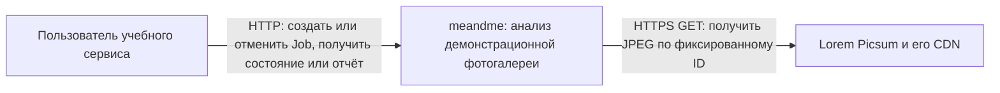
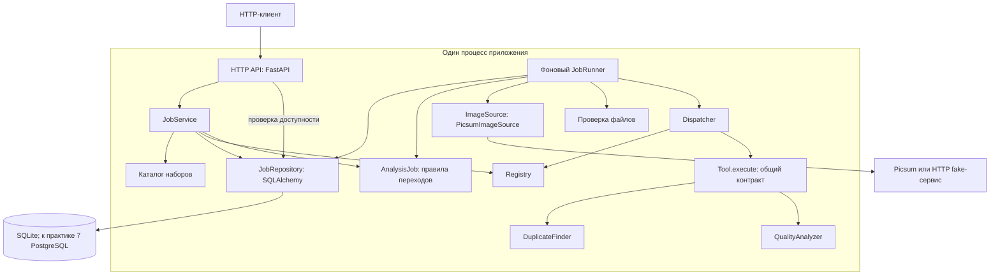
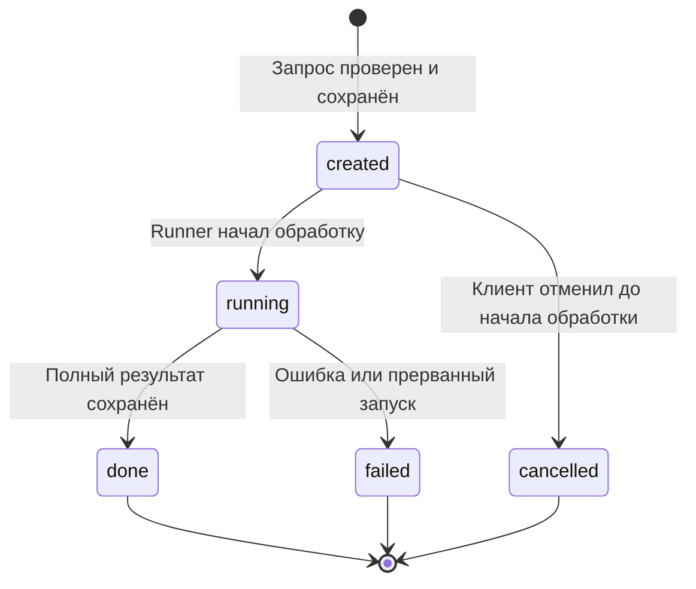

# Архитектура сервиса анализа фотогалереи

Команда meandme, практика 2. Документ задаёт устройство первой версии; реализация выполняется на следующих практиках. Исходные сценарии S1–S6 сохранены в [требованиях](requirements.md).

## Контекст

Стрелки показывают обращения во время работы, от вызывающего к получателю. Ответ возвращается по тому же соединению; обратные стрелки опущены. БД — часть нашей системы, поэтому на контекстной схеме не показана. В автоматических тестах Picsum заменяется управляемым HTTP fake-сервисом.

Пользователь передаёт `dataset_id`, а не URL и не изображение. В каталоге `demo-01` находятся `photo-10`, `photo-29`, `photo-10-copy`: JPEG 800×600 с ID 10 и 29 и копия байтов первого элемента. Копия не вызывает второй сетевой запрос. Оригиналы не изменяются.

## Компоненты

Здесь стрелки показывают вызовы во время работы. `Tool → DuplicateFinder / QualityAnalyzer` обозначает выбор одной реализации общего вызова; оба исполнителя одновременно не запускаются. Это не схема импортов: `JobService` и `JobRunner` обращаются к интерфейсам хранилища и источника; конкретные SQLAlchemy/HTTPX-адаптеры подключаются при запуске. Доменный код не импортирует FastAPI, HTTPX или SQLAlchemy. Ветка операции содержится в Registry; Dispatcher не выбирает исполнителя через `if` по имени класса.

| Компонент | Ответственность | Что скрывает от соседей |
|---|---|---|
| HTTP API | Преобразовать HTTP/JSON в вызов приложения; вернуть документированные ответы | FastAPI, заголовки и сериализацию ошибок |
| JobService | Проверить запрос, создать или отменить Job, прочитать Job и отчёт | Порядок проверок и границы транзакций |
| Каталог | Выдать состав набора для нового Job | URL источника, связи копий и версию каталога |
| AnalysisJob | Разрешить или отклонить смену состояния | Инварианты жизненного цикла |
| JobRepository | Сохранить Job, ключ, снимок набора и итог атомарно | SQL, блокировки, миграции и тип СУБД |
| JobRunner | Взять `created`, загрузить и проверить набор, вызвать Dispatcher, сохранить итог | Фоновое выполнение, обработку исключений и порядок действий |
| Registry | Найти Tool по имени операции | Соответствие имени конкретному классу |
| Dispatcher | Вызвать найденный Tool через общий контракт | Механизм вызова; не скрывает внутри себя алгоритмы анализа |
| Tool | Принять проверенный набор, вернуть результат или доменную ошибку | Реализацию операции |
| DuplicateFinder | Сгруппировать точные копии по SHA-256 | Расчёт хеша и построение групп |
| QualityAnalyzer | Рассчитать яркость, резкость и предупреждения | Декодирование для расчёта и численные формулы |
| Проверка файлов | Проверить формат, размеры и декодируемость перед анализом | Особенности JPEG/PNG и защиту декодера |
| PicsumImageSource | Получить байты через HTTP | Перенаправления, таймауты, повторы и сетевые ошибки |

## Создание и выполнение

1. API проверяет размер тела, JSON, обязательные поля и `Idempotency-Key`.
2. JobService проверяет существующий ключ. При совпадении параметров возвращает прежний Job; при отличии — конфликт. Только для нового ключа проверяет операцию, каталог и свободное место в очереди.
3. В одной транзакции сохраняются Job в `created`, ключ, параметры и снимок состава набора. Клиент получает HTTP 202 с этим снимком состояния и `Location: /jobs/{id}`. К моменту следующего чтения состояние уже может измениться.
4. Один фоновый JobRunner выбирает самый ранний `created` по `created_at`, затем по ID, и атомарно переводит его в `running`. Если Job успели отменить, Runner переходит к следующему. Анализ и сетевые обращения не удерживают транзакцию БД. Блокирующие расчёты выполняются в рабочем потоке того же процесса.
5. Runner получает набор через ImageSource и проверяет файлы. Dispatcher получает Tool из Registry и вызывает `execute`.
6. Полный результат и `done` сохраняются одной транзакцией. При отказе ошибка и `failed` сохраняются одной транзакцией; частичного отчёта нет.

Хранилище — источник истины для очереди, а не список в памяти. Запускается один процесс API с одним Runner: режим нескольких Uvicorn workers запрещён для этой версии. Ключ уникален на уровне БД; создание Job и проверка лимита очереди сериализуются в короткой транзакции. Это нужно и при одном процессе: HTTP-запросы могут пересекаться. Подробности — [ADR-0001](adr/0001-single-process.md) и [ADR-0002](adr/0002-idempotency.md).

Один Runner означает, что задания выполняются по очереди. Например, Runner берёт Job с операцией `find_duplicates`, а Dispatcher выбирает через Registry инструмент `DuplicateFinder`. После сохранения результата Runner берёт следующий Job. Для операции `assess_quality` Dispatcher вызывает другой Tool, `QualityAnalyzer`. Он рассчитывает яркость и резкость и выдаёт предупреждения. Runner отвечает за выполнение задания целиком, каждый Tool выполняет свой анализ.

## Состояния Job

Стрелки показывают разрешённые переходы между состояниями. `[*]` обозначает начало или конец диаграммы. `done` означает успешное выполнение анализа, даже если найдены дубликаты или предупреждения.

| Текущее состояние | Разрешён следующий переход | Запрещено |
|---|---|---|
| `created` | `running`, `cancelled` | `created`, `done`, `failed` |
| `running` | `done`, `failed` | `created`, `running`, `cancelled` |
| `done` | Нет | Любое состояние |
| `failed` | Нет | Любое состояние |
| `cancelled` | Нет | Любое состояние |

Доменная попытка запрещённого перехода возвращает `invalid_transition` с `from` и `to` без изменения Job. Повторное чтение и повтор POST с прежним ключом переходом не являются. Для отмены есть отдельная операция `POST /jobs/{id}/cancel`. `PATCH /jobs/{id}` возвращает 405 `method_not_allowed`, а `/jobs/{id}/restart` — 404 `route_not_found`. Новый анализ создаётся новым POST с новым ключом.

Отмена и захват задания Runner выполняют условное обновление одной записи в БД. Оба перехода требуют, чтобы в момент обновления Job находился в `created`. Если первой зафиксирована отмена, Job получает `cancelled`, освобождает место в очереди и пропускается при обработке. Если первым зафиксирован старт, API возвращает 409 `job_not_cancellable` с актуальным состоянием. Повтор отмены уже отменённого Job возвращает 200 с сохранённым состоянием и временем отмены. [ADR-0004](adr/0004-cancel-created.md)

## Перезапуск и ошибки хранения

До приёма HTTP-запросов и запуска Runner приложение проверяет БД и завершает оставшиеся `running` как `failed` с `execution_interrupted`. Результат незавершённого запуска не восстанавливается. Сохранённые `created` остаются в очереди, а задания в конечных состояниях сохраняются вместе с результатом, ошибкой или временем отмены.

При недоступной БД во время чтения/создания API возвращает 503 `storage_unavailable`. Если соединение оборвалось на подтверждении транзакции, сервер не обещает, что Job не создан: клиент повторяет запрос с прежним ключом. Если БД отказала при записи результата, Runner прекращает брать новые задания и приложение требует перезапуска после восстановления БД. Оно не сообщает `done` без записи результата; оставшийся `running` при старте получает `execution_interrupted`. `/health` возвращает 503, пока БД или Runner не готовы.

Это уточнение относительно p1 зафиксировано в [ADR-0001](adr/0001-single-process.md): состояние после аварии определено, автоматическое продолжение уже начатого анализа не вводится.

## Данные и границы

БД хранит ID, операцию, `dataset_id`, снимок состава набора, `catalog_version`, `analysis_version`, ключ идемпотентности, время переходов, `correlation_id` создания, результат или ошибку. JSON-поля допустимы внутри БД; отдельные JSON-файлы не заменяют хранилище. Байты фотографий существуют только во время анализа и не помещаются в таблицы. Копия элемента ссылается на те же неизменяемые байты в памяти.

Job и ключи хранятся бессрочно. Учебный экземпляр использует общий демонстрационный каталог без учётных записей. Любой клиент, знающий ID, может прочитать Job или отменить его до начала обработки. [Границы демо](adr/0003-demo-boundaries.md)

Формальные схемы — [OpenAPI](api/openapi.yaml), порядок HTTP-проверок и лимиты — [описание API](api/README.md), вход и результат исполнителей — [контракт Tool](tool-contract.md). Проверка решений по картам — [contract-check.md](contract-check.md).
